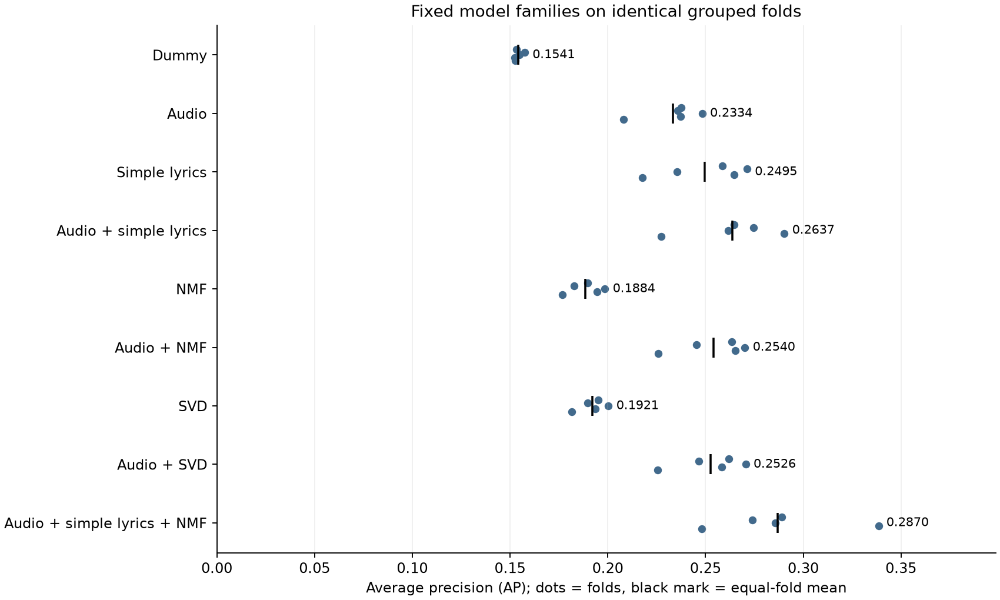
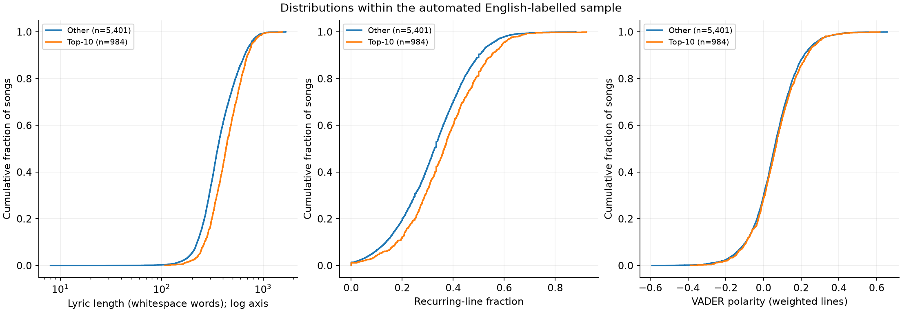

# Do lyric-derived features add predictive information?
Exploratory 2000–2022 matched Billboard corpus update · 15 November 2026

## Main findings

Adding length, recurring-line repetition and polarity to audio increases equal-fold mean AP from **0.2334** to **0.2637**. The prespecified audio + simple lyrics + NMF family reaches **0.2870**, compared with **0.2540** for audio + NMF. All four priority AP differences are positive in each of the five common folds. This supports incremental predictive information in this selected corpus, not causality, significance, better lyrical quality, or an isolated benefit from sentiment alone.

The primary sample has 6,385 songs: 984 Top-10 and 5,401 others. The dummy AP is 0.1541. Simple lyrics alone outperform audio on mean AP here; NMF versus SVD differences are small and do not justify a general superiority claim. The final NMF family was specified before these results, not selected as a winner afterward.

## Actual model scores

| model | ap | roc_auc | precision | recall | f1 | predicted_positive |
| --- | --- | --- | --- | --- | --- | --- |
| Dummy | 0.1541 | 0.5000 | 0.0000 | 0.0000 | 0.0000 | 0.0000 |
| Audio | 0.2334 | 0.6281 | 0.2000 | 0.0010 | 0.0020 | 0.6000 |
| Simple lyrics | 0.2495 | 0.6470 | 0.2000 | 0.0010 | 0.0020 | 0.6000 |
| Audio + simple lyrics | 0.2637 | 0.6639 | 0.5000 | 0.0061 | 0.0120 | 2.2000 |
| NMF | 0.1884 | 0.5492 | 0.0000 | 0.0000 | 0.0000 | 0.0000 |
| Audio + NMF | 0.2540 | 0.6492 | 0.3000 | 0.0040 | 0.0079 | 1.2000 |
| SVD | 0.1921 | 0.5646 | 0.0000 | 0.0000 | 0.0000 | 0.0000 |
| Audio + SVD | 0.2526 | 0.6515 | 0.2800 | 0.0040 | 0.0078 | 2.0000 |
| Audio + simple lyrics + NMF | 0.2870 | 0.6814 | 0.4667 | 0.0111 | 0.0217 | 4.2000 |

Above: all columns are equal-fold means, including `predicted_positive` (mean count per fold). Exact per-fold counts appear below; pooled counts and pooled metrics are in `pooled_oof_metrics.csv`. Averaged precision is not the same as pooled precision, particularly when some folds predict no positives. Low recall at 0.5 is a major practical limitation; these results are not a ready-to-use hit-song classifier.

| comparison | mean_AP_difference | minimum_fold_difference | maximum_fold_difference |
| --- | --- | --- | --- |
| Audio + simple lyrics minus Audio | 0.0303 | 0.0133 | 0.0531 |
| Audio + NMF minus Audio | 0.0206 | 0.0097 | 0.0280 |
| Audio + SVD minus Audio | 0.0192 | 0.0110 | 0.0246 |
| Audio + simple lyrics + NMF minus Audio + NMF | 0.0331 | 0.0154 | 0.0734 |

| comparison | fold | ap | roc_auc |
| --- | --- | --- | --- |
| Audio + simple lyrics minus Audio | 1 | 0.0272 | 0.0531 |
| Audio + simple lyrics minus Audio | 2 | 0.0389 | 0.0275 |
| Audio + simple lyrics minus Audio | 3 | 0.0133 | 0.0278 |
| Audio + simple lyrics minus Audio | 4 | 0.0531 | 0.0382 |
| Audio + simple lyrics minus Audio | 5 | 0.0191 | 0.0323 |
| Audio + NMF minus Audio | 1 | 0.0259 | 0.0409 |
| Audio + NMF minus Audio | 2 | 0.0097 | 0.0048 |
| Audio + NMF minus Audio | 3 | 0.0219 | 0.0390 |
| Audio + NMF minus Audio | 4 | 0.0280 | 0.0207 |
| Audio + NMF minus Audio | 5 | 0.0176 | -0.0000 |
| Audio + SVD minus Audio | 1 | 0.0246 | 0.0420 |
| Audio + SVD minus Audio | 2 | 0.0110 | 0.0127 |
| Audio + SVD minus Audio | 3 | 0.0222 | 0.0394 |
| Audio + SVD minus Audio | 4 | 0.0210 | 0.0152 |
| Audio + SVD minus Audio | 5 | 0.0172 | 0.0077 |
| Audio + simple lyrics + NMF minus Audio + NMF | 1 | 0.0257 | 0.0419 |
| Audio + simple lyrics + NMF minus Audio + NMF | 2 | 0.0286 | 0.0353 |
| Audio + simple lyrics + NMF minus Audio + NMF | 3 | 0.0154 | 0.0134 |
| Audio + simple lyrics + NMF minus Audio + NMF | 4 | 0.0734 | 0.0386 |
| Audio + simple lyrics + NMF minus Audio + NMF | 5 | 0.0223 | 0.0321 |

## Sample and fold accounting

| fold | train_n | train_positive | test_n | test_positive | train_groups | test_groups | vocabulary | empty_test |
| --- | --- | --- | --- | --- | --- | --- | --- | --- |
| 1 | 5112 | 789 | 1273 | 195 | 1707 | 452 | 7837 | 0 |
| 2 | 5096 | 781 | 1289 | 203 | 1732 | 427 | 7669 | 0 |
| 3 | 5105 | 786 | 1280 | 198 | 1740 | 419 | 7883 | 0 |
| 4 | 5113 | 790 | 1272 | 194 | 1740 | 419 | 7836 | 0 |
| 5 | 5114 | 790 | 1271 | 194 | 1717 | 442 | 7553 | 0 |

All models use the same IDs and folds. Group overlap is zero, but individual performers may still cross folds through differing complete credits. No new exact revised-text links were found; historical folds therefore remain directly comparable. No eligible records were dropped for feature computation. Missing/failed sentiment measurements: 0/0 among 6,385 eligible songs (and 0/0 among all 6,546 master records). Valid neutral-zero scores in the eligible sample: 4.

## Lyric distributions by outcome

Top-10 lyrics have median length 431 whitespace words versus 357 for other songs, and median recurring-line fraction 0.3652 versus 0.3265. Their polarity medians are 0.0632 versus 0.0568, with substantial overlap. Length/repetition differences are descriptive associations within this matched corpus; artist, era, style and source transcription can confound them. The nine families assess the three simple features jointly, so no individual-feature contribution is established.

| feature | top10 | n | missing | mean | p05 | p25 | median | p75 | p95 |
| --- | --- | --- | --- | --- | --- | --- | --- | --- | --- |
| p2_word_count | 0 | 5401 | 0 | 402.9350 | 196.0000 | 279.0000 | 357.0000 | 492.0000 | 757.0000 |
| p2_word_count | 1 | 984 | 0 | 464.8506 | 237.0000 | 331.0000 | 431.0000 | 572.0000 | 775.8500 |
| p2_line_repetition | 0 | 5401 | 0 | 0.3234 | 0.0833 | 0.2281 | 0.3265 | 0.4200 | 0.5507 |
| p2_line_repetition | 1 | 984 | 0 | 0.3641 | 0.1111 | 0.2705 | 0.3652 | 0.4631 | 0.5948 |
| p2_sentiment | 0 | 5401 | 0 | 0.0590 | -0.1522 | -0.0148 | 0.0568 | 0.1371 | 0.2684 |
| p2_sentiment | 1 | 984 | 0 | 0.0670 | -0.1406 | -0.0113 | 0.0632 | 0.1435 | 0.2820 |

ECDFs show full distributions and group sizes; length has a labelled logarithmic axis. Quantiles in the table use linear interpolation. The absence of scoring failures is not evidence that sentiment is accurate.

## Provisional component interpretation

| method | component | positive | negative | interpretation |
| --- | --- | --- | --- | --- |
| NMF | 1 | i'm, it's, never, you're, just, gonna | (none) | Mixed general language; theme unclear |
| NMF | 2 | oh, whoa, woah, no, we're, ah | (none) | Vocal syllables / interjections; theme unclear |
| NMF | 3 | nigga, bitch, i'm, shit, niggas, ain't | (none) | Profanity / colloquial diction; theme unclear |
| NMF | 4 | ooh, ah, baby, i'm, can't, lucky | (none) | Vocal syllables / interjections; theme unclear |
| NMF | 5 | na, hey, come, da, tonight, beautiful | (none) | Vocal syllables / interjections; theme unclear |
| NMF | 6 | la, da, you're, dance, like, uh | (none) | Vocal syllables / interjections; theme unclear |
| NMF | 7 | yeah, uh, want, got, that's, no | (none) | Vocal syllables / interjections; theme unclear |
| NMF | 8 | love, way, heart, need, baby, can't | (none) | Love / attachment (provisional) |
| NMF | 9 | baby, girl, hey, got, like, little | (none) | Affectionate address (provisional) |
| NMF | 10 | don't, wanna, know, want, let, no | (none) | Negation / desire language; theme unclear |
| SVD | 1 | i'm, oh, yeah, don't, love, know | (none) | Signed lexical contrast; interpret both poles |
| SVD | 2 | oh, ooh, whoa, love, na, you're | nigga, i'm, bitch, shit, niggas, ain't | Signed lexical contrast; interpret both poles |
| SVD | 3 | love, you're, baby, gonna, i'll, never | oh, yeah, nigga, bitch, niggas, shit | Signed lexical contrast; interpret both poles |
| SVD | 4 | ooh, la, na, yeah, baby, ah | oh, i'm, nigga, whoa, like, niggas | Signed lexical contrast; interpret both poles |
| SVD | 5 | na, la, hey, oh, da, tonight | ooh, love, baby, ah, can't, think | Signed lexical contrast; interpret both poles |
| SVD | 6 | la, da, oh, like, love, nigga | na, ooh, yeah, baby, wanna, know | Signed lexical contrast; interpret both poles |
| SVD | 7 | yeah, love, baby, girl, hey, uh | ooh, i'm, nigga, oh, na, don't | Signed lexical contrast; interpret both poles |
| SVD | 8 | love, nigga, bitch, niggas, shit, fuck | yeah, you're, hey, gonna, little, tonight | Signed lexical contrast; interpret both poles |
| SVD | 9 | baby, girl, wanna, hey, don't, ya | yeah, i'm, not, never, i've, away | Signed lexical contrast; interpret both poles |
| SVD | 10 | don't, know, wanna, want, let, yeah | little, hey, like, girl, she's, got | Signed lexical contrast; interpret both poles |

Five of ten descriptive NMF components remain led by vocal syllables/interjections: oh, ooh, na, la and yeah. The tokenizer repair did not remove these stylistic signals. Love/attachment and affectionate-address labels are tentative lexical summaries; other components capture general language, negation/desire and profanity/colloquial diction. Profanity is not a genre label. Representative examples were inspected privately for the oh, na, love and baby components; the examples support recurring vocabulary, not coherent semantic topics for every component. Full text remains in `../private_component_examples.json`.

SVD component 1 has no negative loadings in this fit; its smallest positive terms must not be called a negative pole. Other SVD components show signed contrasts such as vocal/affectionate language against profanity/colloquial language. Both poles are provided in `descriptive_components.json` with actual loadings. Sign direction and component numbers are fit-specific. Do not align historical, descriptive and fold-specific component numbers without an explicit alignment.

One exploratory descriptive comparison: NMF's oh-led component has mean weight 0.0189 in Top-10 songs versus 0.0150 in other songs. These are unnormalized component scores, not topic percentages; the comparison was selected for illustration and is not a significance test.

## Historical comparability and limits

Historical audio AP was 0.2334 and audio + NMF AP 0.2527; the new values are 0.2334 and 0.2540. Audio agrees because its input and folds are unchanged. Text results include changed preprocessing and tokenization; they cannot isolate an effect of one correction. No new partition was required. All data-driven transformations remain training-only, but repeated inspection of these folds across project stages means this is a development update, not an untouched final external test.

The corpus conditions on having charted and been matched to usable source data. Results do not generalize automatically to all released songs. Complete-credit grouping, possible undetected covers, uncertain matching/transcription, automated language labels, lyric sentiment domain mismatch and temporal shifts remain limitations. The polarity method can score breakup language positively and miss expressive slang; see the private sanity-check note. No comprehensive manual validation or causal identification was performed. Optional random-noise and stricter-language sensitivity analyses were deferred to keep the mandatory comparison focused.

## Complete fold metrics

| fold | model | ap | roc_auc | precision | recall | f1 | predicted_positive |
| --- | --- | --- | --- | --- | --- | --- | --- |
| 1 | Dummy | 0.1532 | 0.5000 | 0.0000 | 0.0000 | 0.0000 | 0 |
| 1 | Audio | 0.2375 | 0.6080 | 0.0000 | 0.0000 | 0.0000 | 0 |
| 1 | Simple lyrics | 0.2587 | 0.6604 | 0.0000 | 0.0000 | 0.0000 | 0 |
| 1 | Audio + simple lyrics | 0.2647 | 0.6611 | 1.0000 | 0.0103 | 0.0203 | 2 |
| 1 | NMF | 0.1896 | 0.5540 | 0.0000 | 0.0000 | 0.0000 | 0 |
| 1 | Audio + NMF | 0.2634 | 0.6489 | 0.0000 | 0.0000 | 0.0000 | 0 |
| 1 | SVD | 0.1951 | 0.5722 | 0.0000 | 0.0000 | 0.0000 | 0 |
| 1 | Audio + SVD | 0.2620 | 0.6499 | 0.0000 | 0.0000 | 0.0000 | 1 |
| 1 | Audio + simple lyrics + NMF | 0.2890 | 0.6908 | 0.6000 | 0.0154 | 0.0300 | 5 |
| 2 | Dummy | 0.1575 | 0.5000 | 0.0000 | 0.0000 | 0.0000 | 0 |
| 2 | Audio | 0.2357 | 0.6433 | 0.0000 | 0.0000 | 0.0000 | 1 |
| 2 | Simple lyrics | 0.2712 | 0.6472 | 0.0000 | 0.0000 | 0.0000 | 1 |
| 2 | Audio + simple lyrics | 0.2745 | 0.6708 | 0.6667 | 0.0099 | 0.0194 | 3 |
| 2 | NMF | 0.1828 | 0.5110 | 0.0000 | 0.0000 | 0.0000 | 0 |
| 2 | Audio + NMF | 0.2453 | 0.6482 | 0.5000 | 0.0099 | 0.0193 | 4 |
| 2 | SVD | 0.1896 | 0.5449 | 0.0000 | 0.0000 | 0.0000 | 0 |
| 2 | Audio + SVD | 0.2466 | 0.6560 | 0.4000 | 0.0099 | 0.0192 | 5 |
| 2 | Audio + simple lyrics + NMF | 0.2739 | 0.6834 | 0.6667 | 0.0197 | 0.0383 | 6 |
| 3 | Dummy | 0.1547 | 0.5000 | 0.0000 | 0.0000 | 0.0000 | 0 |
| 3 | Audio | 0.2483 | 0.6148 | 1.0000 | 0.0051 | 0.0101 | 1 |
| 3 | Simple lyrics | 0.2355 | 0.6164 | 1.0000 | 0.0051 | 0.0101 | 1 |
| 3 | Audio + simple lyrics | 0.2616 | 0.6427 | 0.5000 | 0.0051 | 0.0100 | 2 |
| 3 | NMF | 0.1985 | 0.5851 | 0.0000 | 0.0000 | 0.0000 | 0 |
| 3 | Audio + NMF | 0.2702 | 0.6538 | 1.0000 | 0.0101 | 0.0200 | 2 |
| 3 | SVD | 0.2004 | 0.5910 | 0.0000 | 0.0000 | 0.0000 | 0 |
| 3 | Audio + SVD | 0.2706 | 0.6542 | 1.0000 | 0.0101 | 0.0200 | 2 |
| 3 | Audio + simple lyrics + NMF | 0.2856 | 0.6672 | 0.6667 | 0.0101 | 0.0199 | 3 |
| 4 | Dummy | 0.1525 | 0.5000 | 0.0000 | 0.0000 | 0.0000 | 0 |
| 4 | Audio | 0.2372 | 0.6546 | 0.0000 | 0.0000 | 0.0000 | 0 |
| 4 | Simple lyrics | 0.2645 | 0.6717 | 0.0000 | 0.0000 | 0.0000 | 0 |
| 4 | Audio + simple lyrics | 0.2903 | 0.6928 | 0.3333 | 0.0052 | 0.0102 | 3 |
| 4 | NMF | 0.1945 | 0.5694 | 0.0000 | 0.0000 | 0.0000 | 0 |
| 4 | Audio + NMF | 0.2651 | 0.6753 | 0.0000 | 0.0000 | 0.0000 | 0 |
| 4 | SVD | 0.1937 | 0.5689 | 0.0000 | 0.0000 | 0.0000 | 0 |
| 4 | Audio + SVD | 0.2582 | 0.6698 | 0.0000 | 0.0000 | 0.0000 | 1 |
| 4 | Audio + simple lyrics + NMF | 0.3385 | 0.7139 | 0.4000 | 0.0103 | 0.0201 | 5 |
| 5 | Dummy | 0.1526 | 0.5000 | 0.0000 | 0.0000 | 0.0000 | 0 |
| 5 | Audio | 0.2082 | 0.6196 | 0.0000 | 0.0000 | 0.0000 | 1 |
| 5 | Simple lyrics | 0.2177 | 0.6394 | 0.0000 | 0.0000 | 0.0000 | 1 |
| 5 | Audio + simple lyrics | 0.2273 | 0.6520 | 0.0000 | 0.0000 | 0.0000 | 1 |
| 5 | NMF | 0.1767 | 0.5264 | 0.0000 | 0.0000 | 0.0000 | 0 |
| 5 | Audio + NMF | 0.2258 | 0.6196 | 0.0000 | 0.0000 | 0.0000 | 0 |
| 5 | SVD | 0.1815 | 0.5462 | 0.0000 | 0.0000 | 0.0000 | 0 |
| 5 | Audio + SVD | 0.2254 | 0.6273 | 0.0000 | 0.0000 | 0.0000 | 1 |
| 5 | Audio + simple lyrics + NMF | 0.2481 | 0.6517 | 0.0000 | 0.0000 | 0.0000 | 2 |

Evidence: saved private predictions are independently reloaded to recompute each metric; aggregate CSVs, configuration, source/code hashes and convergence logs are in this run. See `02_methods_and_reproduction.md` for the methodological rationale and primary sentiment documentation.
