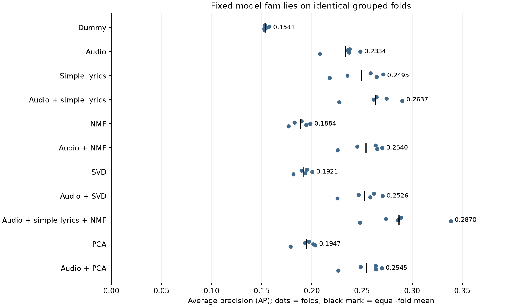

# Preprocessing II v3: centered PCA extension

This extension adds PCA and Audio + PCA to the completed v2 analysis. All nine v2 prediction sets are reused unchanged after verification. All eleven families share the exact **6,385 eligible IDs, 984 positives, targets, groups and five saved folds**. No preprocessing, sentiment, language eligibility or exclusions changed. The completed v2 tree is hash-checked before and after execution.

## Actual comparison

| model | ap | roc_auc | precision | recall | f1 | predicted_positive |
| --- | --- | --- | --- | --- | --- | --- |
| Dummy | 0.1541 | 0.5000 | 0.0000 | 0.0000 | 0.0000 | 0.0000 |
| Audio | 0.2334 | 0.6281 | 0.2000 | 0.0010 | 0.0020 | 0.6000 |
| Simple lyrics | 0.2495 | 0.6470 | 0.2000 | 0.0010 | 0.0020 | 0.6000 |
| Audio + simple lyrics | 0.2637 | 0.6639 | 0.5000 | 0.0061 | 0.0120 | 2.2000 |
| NMF | 0.1884 | 0.5492 | 0.0000 | 0.0000 | 0.0000 | 0.0000 |
| Audio + NMF | 0.2540 | 0.6492 | 0.3000 | 0.0040 | 0.0079 | 1.2000 |
| SVD | 0.1921 | 0.5646 | 0.0000 | 0.0000 | 0.0000 | 0.0000 |
| Audio + SVD | 0.2526 | 0.6515 | 0.2800 | 0.0040 | 0.0078 | 2.0000 |
| Audio + simple lyrics + NMF | 0.2870 | 0.6814 | 0.4667 | 0.0111 | 0.0217 | 4.2000 |
| PCA | 0.1947 | 0.5737 | 0.0000 | 0.0000 | 0.0000 | 0.0000 |
| Audio + PCA | 0.2545 | 0.6525 | 0.2800 | 0.0040 | 0.0078 | 2.2000 |

All columns above are **equal-fold means**; predicted_positive is the mean count per fold. `fold_metrics.csv` contains exact fold counts; `pooled_oof_metrics.csv` separately reports pooled scores and total predicted positives. AP means average precision, not trapezoidal PR-AUC. Precision/recall/F1 use fixed threshold 0.5 and zero_division=0, as in v2. No threshold was optimized.



| comparison | mean_AP_difference | min_fold_AP_difference | max_fold_AP_difference |
| --- | --- | --- | --- |
| PCA minus NMF | 0.0063 | 0.0023 | 0.0102 |
| PCA minus SVD | 0.0027 | -0.0025 | 0.0096 |
| Audio + PCA minus Audio + NMF | 0.0005 | -0.0011 | 0.0033 |
| Audio + PCA minus Audio + SVD | 0.0019 | -0.0009 | 0.0058 |
| Audio + PCA minus Audio | 0.0211 | 0.0130 | 0.0268 |

These paired differences describe the same held-out songs in each fold. A small numeric lead does not establish a meaningful winner. The five training sets overlap, so no independent-sample significance test is applied. Representation explained variance does not identify which model predicts Top-10 status best. Complete-credit grouping still permits performers shared between solo and collaborative credits; reused development folds and selected matched charting songs limit generalization. Human review remains required before Canvas submission.

## Feature-set mapping

| Family | Classifier inputs |
| --- | --- |
| Dummy | Training prevalence; no predictors |
| Audio | 10 audio medians |
| Simple lyrics | log(1 + whitespace word count), recurring-line fraction, VADER polarity |
| Audio + simple lyrics | 10 audio medians + the 3 simple lyric features |
| NMF / SVD / PCA | 10 corresponding fold-fitted component scores |
| Audio + NMF / SVD / PCA | 10 audio medians + 10 corresponding component scores |
| Audio + simple lyrics + NMF | 10 audio medians + 3 simple lyric features + 10 NMF scores |

## Centered PCA extension

PCA uses the same revised word-unigram TF-IDF as v2, with **10 components**, `svd_solver="arpack"`, seed 42, tolerance 0 (machine precision), `whiten=False`, `copy=True`. The installed sklearn 1.9.1 documentation and `_fit_truncated` source were inspected and saved in the extension directory. ARPACK uses an implicit column-mean offset on sparse input. No dense real-data word matrix or covariance matrix was constructed, and no alternative solver or component count was selected against scores. ARPACK exceptions abort rather than substitute uncentered SVD. Its iteration count is not exposed; successful return and captured warnings are recorded.

PCA subtracts **training-set TF-IDF column means**. Individual word columns are **not standardized**: we retain TF-IDF's weighting geometry rather than giving every rare/low-variance word unit variance. This differs from the training-only standard scaling of the final 10 or 20 classifier inputs. The final imputation/scaling and logistic settings exactly match v2: median imputation, standard scaling, L2 C=1, no class weighting, lbfgs, tolerance 1e-4, seed 42, max_iter 2000 (4000 only for a convergence warning). PCA alone has 10 coefficients plus intercept; Audio + PCA has 20 plus intercept.

Each fold fits vocabulary, IDF and PCA only on its training songs. Checks compare the stored PCA mean with the independent training sparse-column mean, verify zero-mean training component scores, and verify held-out scores equal `X_test @ components.T - training_mean @ components.T`, without changing fitted state. Synthetic sparse PCA is also checked against dense centered PCA on a small fixture. Saved means/components and fit IDs remain private.

**NMF** is nonnegative additive factorization. **SVD/LSA** is uncentered TruncatedSVD. **PCA** here is genuinely centered, with signed orthogonal axes. All have 10 components but differ in objectives and constraints; equal counts do not equalize complete pipeline capacity. Explained variance ratios measure training TF-IDF variance captured, not predictive accuracy or proportions of lyrical topics.

Source: installed `sklearn.decomposition.PCA` documentation and implementation (path/hash and exact text saved in the extension manifest and `installed_pca_documentation.txt`).


## Memory and numerical results

| fold | vocabulary | training_CSR_MiB | hypothetical_dense_training_MiB | hypothetical_dense_covariance_MiB |
| --- | --- | --- | --- | --- |
| 1 | 7837 | 4.9477 | 305.6545 | 468.5865 |
| 2 | 7669 | 4.8508 | 298.1661 | 448.7119 |
| 3 | 7883 | 4.9816 | 307.0275 | 474.1035 |
| 4 | 7836 | 5.0015 | 305.6753 | 468.4669 |
| 5 | 7553 | 4.8040 | 294.6933 | 435.2402 |

These are array-size estimates, not measured peak process memory. Dense estimates exclude copies and solver workspace. Sparse ARPACK was used throughout; its dense outputs are only 10-dimensional scores, component loadings and column means. All five PCA calls returned successfully. Captured warnings, classifier convergence and iteration details are in `../fold_details.json`.

| fold | PC1 | PC2 | PC3 | PC4 | PC5 | PC6 | PC7 | PC8 | PC9 | PC10 | total |
| --- | --- | --- | --- | --- | --- | --- | --- | --- | --- | --- | --- |
| 1 | 0.0131 | 0.0105 | 0.0095 | 0.0083 | 0.0082 | 0.0076 | 0.0065 | 0.0061 | 0.0053 | 0.0045 | 0.0798 |
| 2 | 0.0134 | 0.0103 | 0.0093 | 0.0083 | 0.0080 | 0.0070 | 0.0066 | 0.0061 | 0.0053 | 0.0046 | 0.0790 |
| 3 | 0.0134 | 0.0105 | 0.0096 | 0.0086 | 0.0082 | 0.0078 | 0.0066 | 0.0064 | 0.0052 | 0.0045 | 0.0807 |
| 4 | 0.0138 | 0.0106 | 0.0088 | 0.0085 | 0.0073 | 0.0070 | 0.0066 | 0.0059 | 0.0052 | 0.0047 | 0.0785 |
| 5 | 0.0133 | 0.0099 | 0.0094 | 0.0084 | 0.0082 | 0.0075 | 0.0067 | 0.0062 | 0.0053 | 0.0046 | 0.0795 |

Ratios above concern each training fold only. No all-data PCA interpretation fit was needed for this predictive extension.

## Paired fold results

| comparison | fold | ap | roc_auc |
| --- | --- | --- | --- |
| PCA minus NMF | 1 | 0.0073 | 0.0221 |
| PCA minus NMF | 2 | 0.0102 | 0.0335 |
| PCA minus NMF | 3 | 0.0029 | 0.0123 |
| PCA minus NMF | 4 | 0.0088 | 0.0228 |
| PCA minus NMF | 5 | 0.0023 | 0.0320 |
| PCA minus SVD | 1 | 0.0018 | 0.0040 |
| PCA minus SVD | 2 | 0.0035 | -0.0003 |
| PCA minus SVD | 3 | 0.0010 | 0.0064 |
| PCA minus SVD | 4 | 0.0096 | 0.0234 |
| PCA minus SVD | 5 | -0.0025 | 0.0122 |
| Audio + PCA minus Audio + NMF | 1 | 0.0003 | 0.0024 |
| Audio + PCA minus Audio + NMF | 2 | 0.0033 | 0.0088 |
| Audio + PCA minus Audio + NMF | 3 | -0.0006 | -0.0012 |
| Audio + PCA minus Audio + NMF | 4 | -0.0011 | -0.0027 |
| Audio + PCA minus Audio + NMF | 5 | 0.0006 | 0.0095 |
| Audio + PCA minus Audio + SVD | 1 | 0.0016 | 0.0014 |
| Audio + PCA minus Audio + SVD | 2 | 0.0020 | 0.0010 |
| Audio + PCA minus Audio + SVD | 3 | -0.0009 | -0.0016 |
| Audio + PCA minus Audio + SVD | 4 | 0.0058 | 0.0028 |
| Audio + PCA minus Audio + SVD | 5 | 0.0010 | 0.0018 |
| Audio + PCA minus Audio | 1 | 0.0261 | 0.0434 |
| Audio + PCA minus Audio | 2 | 0.0130 | 0.0136 |
| Audio + PCA minus Audio | 3 | 0.0213 | 0.0378 |
| Audio + PCA minus Audio | 4 | 0.0268 | 0.0180 |
| Audio + PCA minus Audio | 5 | 0.0182 | 0.0095 |

## All fold metrics

| fold | model | ap | roc_auc | precision | recall | f1 | predicted_positive |
| --- | --- | --- | --- | --- | --- | --- | --- |
| 1 | Dummy | 0.1532 | 0.5000 | 0.0000 | 0.0000 | 0.0000 | 0 |
| 1 | Audio | 0.2375 | 0.6080 | 0.0000 | 0.0000 | 0.0000 | 0 |
| 1 | Simple lyrics | 0.2587 | 0.6604 | 0.0000 | 0.0000 | 0.0000 | 0 |
| 1 | Audio + simple lyrics | 0.2647 | 0.6611 | 1.0000 | 0.0103 | 0.0203 | 2 |
| 1 | NMF | 0.1896 | 0.5540 | 0.0000 | 0.0000 | 0.0000 | 0 |
| 1 | Audio + NMF | 0.2634 | 0.6489 | 0.0000 | 0.0000 | 0.0000 | 0 |
| 1 | SVD | 0.1951 | 0.5722 | 0.0000 | 0.0000 | 0.0000 | 0 |
| 1 | Audio + SVD | 0.2620 | 0.6499 | 0.0000 | 0.0000 | 0.0000 | 1 |
| 1 | Audio + simple lyrics + NMF | 0.2890 | 0.6908 | 0.6000 | 0.0154 | 0.0300 | 5 |
| 2 | Dummy | 0.1575 | 0.5000 | 0.0000 | 0.0000 | 0.0000 | 0 |
| 2 | Audio | 0.2357 | 0.6433 | 0.0000 | 0.0000 | 0.0000 | 1 |
| 2 | Simple lyrics | 0.2712 | 0.6472 | 0.0000 | 0.0000 | 0.0000 | 1 |
| 2 | Audio + simple lyrics | 0.2745 | 0.6708 | 0.6667 | 0.0099 | 0.0194 | 3 |
| 2 | NMF | 0.1828 | 0.5110 | 0.0000 | 0.0000 | 0.0000 | 0 |
| 2 | Audio + NMF | 0.2453 | 0.6482 | 0.5000 | 0.0099 | 0.0193 | 4 |
| 2 | SVD | 0.1896 | 0.5449 | 0.0000 | 0.0000 | 0.0000 | 0 |
| 2 | Audio + SVD | 0.2466 | 0.6560 | 0.4000 | 0.0099 | 0.0192 | 5 |
| 2 | Audio + simple lyrics + NMF | 0.2739 | 0.6834 | 0.6667 | 0.0197 | 0.0383 | 6 |
| 3 | Dummy | 0.1547 | 0.5000 | 0.0000 | 0.0000 | 0.0000 | 0 |
| 3 | Audio | 0.2483 | 0.6148 | 1.0000 | 0.0051 | 0.0101 | 1 |
| 3 | Simple lyrics | 0.2355 | 0.6164 | 1.0000 | 0.0051 | 0.0101 | 1 |
| 3 | Audio + simple lyrics | 0.2616 | 0.6427 | 0.5000 | 0.0051 | 0.0100 | 2 |
| 3 | NMF | 0.1985 | 0.5851 | 0.0000 | 0.0000 | 0.0000 | 0 |
| 3 | Audio + NMF | 0.2702 | 0.6538 | 1.0000 | 0.0101 | 0.0200 | 2 |
| 3 | SVD | 0.2004 | 0.5910 | 0.0000 | 0.0000 | 0.0000 | 0 |
| 3 | Audio + SVD | 0.2706 | 0.6542 | 1.0000 | 0.0101 | 0.0200 | 2 |
| 3 | Audio + simple lyrics + NMF | 0.2856 | 0.6672 | 0.6667 | 0.0101 | 0.0199 | 3 |
| 4 | Dummy | 0.1525 | 0.5000 | 0.0000 | 0.0000 | 0.0000 | 0 |
| 4 | Audio | 0.2372 | 0.6546 | 0.0000 | 0.0000 | 0.0000 | 0 |
| 4 | Simple lyrics | 0.2645 | 0.6717 | 0.0000 | 0.0000 | 0.0000 | 0 |
| 4 | Audio + simple lyrics | 0.2903 | 0.6928 | 0.3333 | 0.0052 | 0.0102 | 3 |
| 4 | NMF | 0.1945 | 0.5694 | 0.0000 | 0.0000 | 0.0000 | 0 |
| 4 | Audio + NMF | 0.2651 | 0.6753 | 0.0000 | 0.0000 | 0.0000 | 0 |
| 4 | SVD | 0.1937 | 0.5689 | 0.0000 | 0.0000 | 0.0000 | 0 |
| 4 | Audio + SVD | 0.2582 | 0.6698 | 0.0000 | 0.0000 | 0.0000 | 1 |
| 4 | Audio + simple lyrics + NMF | 0.3385 | 0.7139 | 0.4000 | 0.0103 | 0.0201 | 5 |
| 5 | Dummy | 0.1526 | 0.5000 | 0.0000 | 0.0000 | 0.0000 | 0 |
| 5 | Audio | 0.2082 | 0.6196 | 0.0000 | 0.0000 | 0.0000 | 1 |
| 5 | Simple lyrics | 0.2177 | 0.6394 | 0.0000 | 0.0000 | 0.0000 | 1 |
| 5 | Audio + simple lyrics | 0.2273 | 0.6520 | 0.0000 | 0.0000 | 0.0000 | 1 |
| 5 | NMF | 0.1767 | 0.5264 | 0.0000 | 0.0000 | 0.0000 | 0 |
| 5 | Audio + NMF | 0.2258 | 0.6196 | 0.0000 | 0.0000 | 0.0000 | 0 |
| 5 | SVD | 0.1815 | 0.5462 | 0.0000 | 0.0000 | 0.0000 | 0 |
| 5 | Audio + SVD | 0.2254 | 0.6273 | 0.0000 | 0.0000 | 0.0000 | 1 |
| 5 | Audio + simple lyrics + NMF | 0.2481 | 0.6517 | 0.0000 | 0.0000 | 0.0000 | 2 |
| 1 | PCA | 0.1969 | 0.5761 | 0.0000 | 0.0000 | 0.0000 | 0 |
| 1 | Audio + PCA | 0.2636 | 0.6513 | 0.0000 | 0.0000 | 0.0000 | 1 |
| 2 | PCA | 0.1931 | 0.5446 | 0.0000 | 0.0000 | 0.0000 | 0 |
| 2 | Audio + PCA | 0.2486 | 0.6570 | 0.4000 | 0.0099 | 0.0192 | 5 |
| 3 | PCA | 0.2014 | 0.5974 | 0.0000 | 0.0000 | 0.0000 | 0 |
| 3 | Audio + PCA | 0.2696 | 0.6526 | 1.0000 | 0.0101 | 0.0200 | 2 |
| 4 | PCA | 0.2032 | 0.5922 | 0.0000 | 0.0000 | 0.0000 | 0 |
| 4 | Audio + PCA | 0.2640 | 0.6726 | 0.0000 | 0.0000 | 0.0000 | 2 |
| 5 | PCA | 0.1790 | 0.5584 | 0.0000 | 0.0000 | 0.0000 | 0 |
| 5 | Audio + PCA | 0.2264 | 0.6291 | 0.0000 | 0.0000 | 0.0000 | 1 |

## Provenance and reproduction

Immutable base: `D:\Projects\music-success-nlp\data\processed\preprocessing_ii_20261115_v2`. The extension manifest records SHA-256 hashes for every v2 file, configuration, inspected PCA implementation and extension code. The existing cleaned sample is copied byte-for-byte into this new submission. `04_v2_analysis_update.md` retains the historical nine-model narrative; the current table and figure above supersede its comparison for this extension. The old nine-model figure is preserved as `v2_model_ap.png`.

```powershell
uv run python -m unittest discover -s tests -v
uv run python src/16_centered_pca_extension.py --output data/processed/preprocessing_ii_pca_reproduction
uv run python src/16_centered_pca_extension.py --verify data/processed/preprocessing_ii_pca_reproduction
```

Use a new output directory. No upstream preprocessing or v2 model refitting is necessary. Private prediction rows and PCA vocabulary/loadings stay Git-ignored. Nothing is pushed, merged or uploaded.
