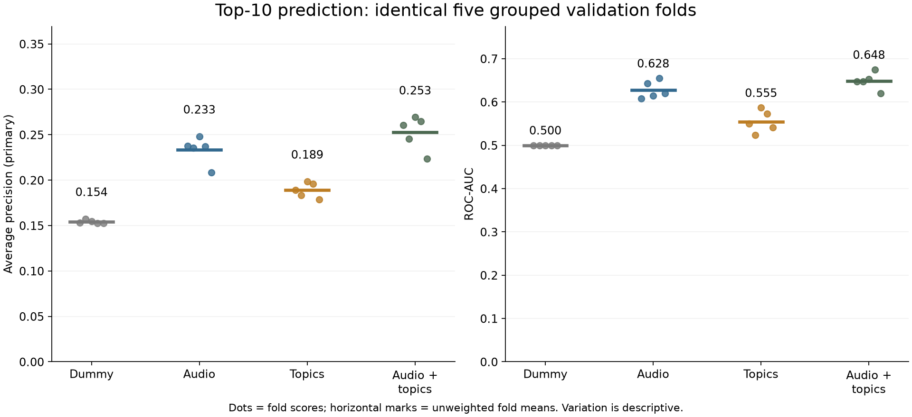
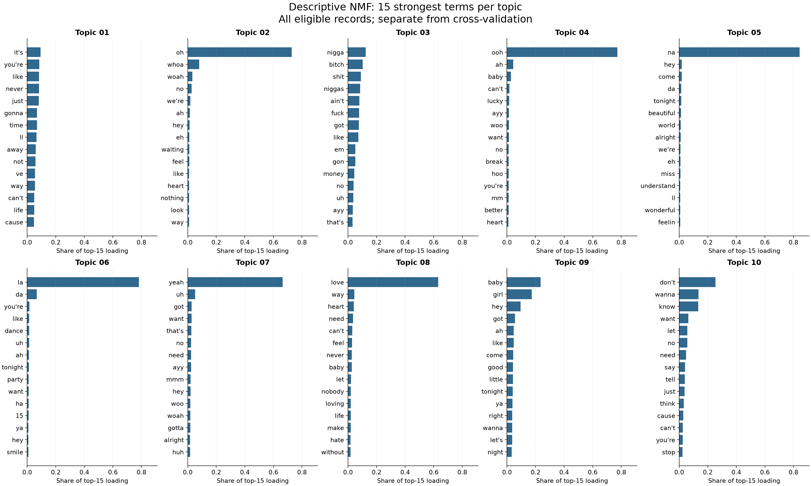

# Preliminary topics and Top-10 prediction

Executed 2026-11-01. Automated English screening retains **6,385 songs**, including **984 Top-10** and **5,401 non-Top-10** records (15.41% positive). Audio + topics has mean average precision (AP) **0.2527**, versus **0.2334** for audio; the paired mean difference is **+0.0193**. These are preliminary associations, with descriptive fold variation and no significance or causal claim.

## Sample and preprocessing

Source: `data/processed/billboard_lyrics_corrected_2000_2022.parquet` (6,546 records). The existing `lyric_language == 'en'` rule removes 161 records from modelling only. This is automated English screening, not verified English-only text; slang and code-switching remain. `lyrics_deduplicated` is used after checking the existing repetition audit and its source hash; the audit, integration and manual review were not rerun. Every source row/column and file is preserved. Unresolved repetitions stay unchanged and eligible; flags are retained for inspection, never predictors.

| Eligible-sample attribute | Records |
| --- | --- |
| lyric_language_uncertain | 92 |
| lyric_language_mixed_candidate | 27 |
| lyric_language_short | 10 |
| lyric_encoding_review | 2 |
| lyric_near_duplicate_candidate | 2 |
| full_block_dedup_applied | 1 |
| full-block flagged | 903 |
| unresolved full-block flags retained | 902 |

Main outcome: `peak_rank <= 10` versus `> 10`, verified against `top10`. An **illustrative, not professor-confirmed** gap excluding ranks 11–15 would remove 330 negatives and leave 6055 records (984 positive / 5071 negative). This is a count only: no gap-outcome models or extra searches were run.

The ten audio predictors are the existing medians: `danceability_median`, `energy_median`, `loudness_median`, `speechiness_median`, `acousticness_median`, `instrumentalness_median`, `liveness_median`, `valence_median`, `tempo_median`, `duration_ms_median`. Missing/nonfinite cells: 0; affected records: 0. Numerical inputs receive training-only median imputation (all-missing training columns retain a zero fallback) and standard scaling. Duration is an audio duration field, not a lyric-length feature. No lyric length, lexical diversity, repetition, sentiment, chart history, Grammy outcome, identifier, artist-name or quality-flag predictor is used.

## Validation design and leakage boundaries

Five `StratifiedGroupKFold` folds, shuffle=True, random_state=42, are materialized once and reused for every model. 2159 connected groups cover the eligible records; group-size min/median/p95/max = [1.0, 1.0, 11.0, 134.0]; 1474 are singletons. Largest-group share = 2.10%. Groups use existing `artist_norm` (the entire normalized credit, with featured artists/order retained), existing text hashes/duplicate-group IDs, and the documented shared-text candidate 4480/4481 (Glee Cast / Katy Perry, “I Kissed A Girl”). Connected components are formed on all source rows before the language filter. The candidate pair is a conservative leakage constraint, not a newly confirmed cover classification.

Complete-credit grouping can place a performer’s solo and collaborative credits in different folds. Undetected covers/shared texts, punctuation-normalization collisions and temporal shifts remain possible. This is **not fully unseen-performer evaluation**, nor a future-year forecasting test. Known group links are used only for partitioning; they are not features. No elaborate artist parser or new cover search was used.

| Fold | Train n | Train + | Validation n | Validation + | Val. prevalence | Train groups | Val. groups | Overlap |
| --- | --- | --- | --- | --- | --- | --- | --- | --- |
| 1 | 5112 | 789 | 1273 | 195 | 0.1532 | 1707 | 452 | 0 |
| 2 | 5096 | 781 | 1289 | 203 | 0.1575 | 1732 | 427 | 0 |
| 3 | 5105 | 786 | 1280 | 198 | 0.1547 | 1740 | 419 | 0 |
| 4 | 5113 | 790 | 1272 | 194 | 0.1525 | 1740 | 419 | 0 |
| 5 | 5114 | 790 | 1271 | 194 | 0.1526 | 1717 | 442 | 0 |

Each fold fits a fresh vocabulary, IDF and NMF using only training lyrics. The same training-fitted topics feed L and A+L. Each numerical pipeline separately fits its imputer, scaler and classifier on training rows; held-out rows only pass through `transform` / `predict_proba`. No setting is selected from validation scores.

TF-IDF: word unigrams, lowercase=True, min_df=5, max_df=0.95, max_features=None, sublinear_tf=False, norm="l2", smooth_idf=True, use_idf=True, binary=False. Stopwords: the fixed scikit-learn 1.9.1 `ENGLISH_STOP_WORDS` list minus cannot, cant, couldnt, hasnt, neither, never, no, nobody, none, nor, not, nothing, nowhere, without; the exact 304-word list and its hash are stored privately. No data-driven stopwords or lemmatization. The apostrophe-aware Unicode token pattern `(?u)\b\w\w+(?:['’]\w+)*\b` retains contractions such as negated auxiliaries as single word tokens; one-character tokens are omitted. Explicit tests verify negation retention.

NMF: 10 components, init="nndsvda", random_state=42, max_iter=500, solver="cd", beta_loss="frobenius", tol=1e-4, no additional regularization. A convergence warning permits one numerical-budget increase to 1,000 iterations, without tuning against scores. Logistic regression: pure L2 (`l1_ratio=0` in installed sklearn), C=1, class_weight=None, max_iter=2000, solver="lbfgs". DummyClassifier(strategy="prior") predicts the training prevalence.

## Executed model comparison

| Model | Mean fold AP | Mean fold ROC-AUC |
| --- | --- | --- |
| Dummy | 0.1541 | 0.5000 |
| Audio | 0.2334 | 0.6281 |
| Topics | 0.1891 | 0.5547 |
| Audio + topics | 0.2527 | 0.6482 |

| Fold | Model | Average precision | ROC-AUC |
| --- | --- | --- | --- |
| 1 | Dummy | 0.1532 | 0.5000 |
| 1 | Audio | 0.2375 | 0.6080 |
| 1 | Topics | 0.1893 | 0.5494 |
| 1 | Audio + topics | 0.2603 | 0.6471 |
| 2 | Dummy | 0.1575 | 0.5000 |
| 2 | Audio | 0.2357 | 0.6433 |
| 2 | Topics | 0.1833 | 0.5231 |
| 2 | Audio + topics | 0.2454 | 0.6469 |
| 3 | Dummy | 0.1547 | 0.5000 |
| 3 | Audio | 0.2483 | 0.6148 |
| 3 | Topics | 0.1987 | 0.5867 |
| 3 | Audio + topics | 0.2693 | 0.6524 |
| 4 | Dummy | 0.1525 | 0.5000 |
| 4 | Audio | 0.2372 | 0.6546 |
| 4 | Topics | 0.1957 | 0.5732 |
| 4 | Audio + topics | 0.2649 | 0.6747 |
| 5 | Dummy | 0.1526 | 0.5000 |
| 5 | Audio | 0.2082 | 0.6196 |
| 5 | Topics | 0.1787 | 0.5411 |
| 5 | Audio + topics | 0.2236 | 0.6198 |

| Fold | Paired AP: combined minus audio |
| --- | --- |
| 1 | +0.0229 |
| 2 | +0.0097 |
| 3 | +0.0210 |
| 4 | +0.0277 |
| 5 | +0.0154 |
| Mean | +0.0193 |

AP is **average precision**, not trapezoidal PR-AUC. Means weight the five folds equally. A constant-score dummy has fold AP equal to validation prevalence and ROC-AUC 0.5, although its predicted probability is training prevalence. Fold differences share training records and are not independent replicates; no confidence interval, p-value or significance claim is made.

## Convergence and empty vectors

| Fit | Vocabulary | NMF train iterations | Train converged | Transform converged | Empty train | Empty held-out |
| --- | --- | --- | --- | --- | --- | --- |
| Fold 1 | 7823 | 48 | True | True | 0 | 0 |
| Fold 2 | 7654 | 45 | True | True | 0 | 0 |
| Fold 3 | 7869 | 48 | True | True | 0 | 0 |
| Fold 4 | 7818 | 86 | True | True | 0 | 0 |
| Fold 5 | 7537 | 45 | True | True | 0 | 0 |
| All-data descriptive | 8857 | 42 | True | N/A | 0 | N/A |

NMF training retries: 0; validation-transform retries: 0. Logistic fits with convergence warnings: 0/15. Empty text vectors are retained with zero topic weights; none are silently dropped. Their stable IDs, fold assignments and predictions are recorded in the private OOF file. Convergence warning details and iteration budgets are preserved in the private run manifest.

## Separate descriptive topics

After validation, a new TF-IDF/NMF model is fitted on all eligible records with the same fixed settings. It is never used to produce the validation scores above. Topic indices are local to this descriptive fit, not aligned to fold-specific topics. Top terms are ordered by component loading; representatives are the three songs with largest raw topic weights (ties broken by stable ID). Loadings are not probabilities. Topic labels remain provisional; unclear components are explicitly left uninterpreted.

| Topic | Provisional label | Top 15 terms | Representative IDs / titles |
| --- | --- | --- | --- |
| 1 | Mixed general language; theme unclear | it's, you're, like, never, just, gonna, time, ll, away, not, ve, way, can't, life, cause | 2888: Everywhere; 4159: Home; 6567: Never Gonna Be Alone |
| 2 | Vocal syllables / interjections; theme unclear | oh, whoa, woah, no, we're, ah, hey, eh, waiting, feel, like, heart, nothing, look, way | 4892: In Your Arms; 5131: Just Hold On; 4160: Home |
| 3 | Profanity / colloquial diction; theme unclear | nigga, bitch, shit, niggas, ain't, fuck, got, like, em, gon, money, no, uh, ayy, that's | 6536: Neighborhood Superstar; 2269: Dead Trollz; 5259: Know Like I Know |
| 4 | Vocal syllables / interjections; theme unclear | ooh, ah, baby, can't, lucky, ayy, woo, want, no, break, hoo, you're, mm, better, heart | 8153: Shadowplay; 9572: This Is What You Came For; 10322: What Are You So Afraid Of |
| 5 | Vocal syllables / interjections; theme unclear | na, hey, come, da, tonight, beautiful, world, alright, we're, eh, miss, understand, ll, wonderful, feelin | 2704: E-Pro; 6501: Na Na Na (Na Na Na Na Na Na Na Na Na); 7743: Rich Girl |
| 6 | Vocal syllables / interjections; theme unclear | la, da, you're, like, dance, uh, ah, tonight, party, want, ha, 15, ya, hey, smile | 10571: Who's That Girl?; 1655: Can't Get You Out Of My Head; 6616: New Soul |
| 7 | Vocal syllables / interjections; theme unclear | yeah, uh, got, want, that's, no, need, ayy, mmm, hey, woo, woah, gotta, alright, huh | 1794: Cheers (Drink To That); 4522: I Love Me; 10481: Where Have You Been |
| 8 | Love / attachment (provisional) | love, way, heart, need, can't, feel, never, baby, let, nobody, loving, life, make, hate, without | 10566: Who You Love; 8207: She Is Love; 8911: Summertime Magic |
| 9 | Affectionate address (provisional) | baby, girl, hey, got, ah, like, come, good, little, tonight, ya, right, wanna, let's, night | 817: Baby; 7320: Plastic Off The Sofa; 819: Baby |
| 10 | Negation / desire language; theme unclear | don't, wanna, know, want, let, no, need, say, tell, just, think, cause, can't, you're, stop | 9519: They Don't Know; 2567: Don't Think They Know; 9072: Take Your Time |

Five components are dominated by vocal syllables/interjections (2, 4, 5, 6, 7), while topic 8 supports a provisional love/attachment label. These are not ten distinct semantic themes. Profanity/colloquial diction in topic 3 describes vocabulary, not performer identity. Fragments such as `ll` and `ve` remain where source contractions are separated; no extra cleaning or stopword changes were chosen after seeing results.

## Preprocessing I implications and eight-slide outline

Conservative cleaning preserves within-song structure. The existing repetition audit supports normalized linear unigram TF-IDF invariance for exact full-block repeats, so unresolved songs need not be shortened to run this representation. It does not establish that the source text is correct. Tokenization, negation retention, automated language screening and grouped evaluation are substantive preprocessing choices. These observational matched Billboard records cannot establish that lyrics cause success; matching, language-detection and text/audio-version uncertainty remain. Ten coarse topics may reflect vocal fragments or genre-associated diction as well as themes. Improving or declining AP in these folds alone does not justify searching settings on the same held-out results.

1. **Question and unit:** do lyric topics add to audio for Top-10 classification? One song–artist record; observational scope.
2. **Prepared sample:** 6,546 source records → 6,385 automated-English records; 984 / 5401 classes.
3. **Cleaning decisions:** use Stage 11 text; preserve negation, unresolved repetitions and flags; show the metadata-only sample.
4. **Text representation:** fixed unigram TF-IDF → 10-component NMF; distinguish fold-fitted representation from descriptive topics.
5. **Leakage controls:** complete-credit groups plus documented shared-text links; show group sizes/fold counts and residual collaboration risk.
6. **Prediction comparison:** dummy / audio / topics / combined; show the model figure, AP and ROC-AUC.
7. **Results and topic examples:** paired AP mean +0.0193; display top-term figure and provisional labels, without significance claims.
8. **Limits and next decisions:** automated language errors, topic ambiguity, version uncertainty, descriptive fold variation; rank-11–15 gap remains illustrative only.

## Cleaned-data sample and column guide

The 25-row [sample CSV](preprocessing_I_sample.csv) is a deterministic class-stratified metadata extract (seed 42; 4 Top-10 and 21 other songs), not representative evidence for prevalence. All values in source columns are copied unchanged; no full lyrics or comparison strings are exported.

| Columns | Meaning / modelling role |
| --- | --- |
| billboard_source_row; lyric_representative_spotify_id | Stable source/representative IDs; never predictors. |
| Song; Artist; first_chart_date | Original title, full credit and first observed chart date; context only. |
| peak_rank; top10 | Observed outcome and binary label; never input features. |
| artist_norm; evaluation_group; validation_fold | Existing complete-credit key, connected group and assigned fold; partitioning only. |
| lyric_language; lyric_language_score | Existing top detector label/score; score is not calibrated correctness probability. |
| lyric_language_uncertain; lyric_language_mixed_candidate; lyric_language_short | Retained language-screen flags; not features. |
| lyric_full_block_repeats; full_block_dedup_status; full_block_dedup_applied | Historical repetition multiplicity and correction evidence status; not features. |
| lyric_encoding_review; lyric_near_duplicate_candidate | Existing quality/shared-text flags; not features. |
| lyric_resolution_confidence; audio_resolution_confidence; any_missing_audio_value | Consolidation diagnostics; not features. |
| danceability_median, energy_median, loudness_median, speechiness_median, acousticness_median, instrumentalness_median, liveness_median, valence_median, tempo_median, duration_ms_median | Only the ten whitelisted audio medians enter A and A+L. Duration is milliseconds; tempo is BPM; loudness is dB; other fields retain source scales. |

## Reproducibility and focused checks

Environment: Python 3.12.14, scikit-learn 1.9.1, NumPy 2.5.4, Polars 2.0.0; dependencies managed with `uv` and locked in `uv.lock`. Run `uv run python src/12_topics_and_top10_prediction.py`. No other modelling work was found to reuse. No AGENTS.md was found in the repository or parent directories; README preservation rules were followed.

Passed checks: source SHA-256 and prior-audit hash match; unique IDs and exact target agreement; one held-out prediction per eligible row in original order for each model; both classes in every fold; zero group overlap; known cover pair stays together; actual train-only IDF formula and document-frequency thresholds; unchanged vocabulary/IDF/NMF components after held-out transforms; training-only imputer medians and scaler sample counts; predictor whitelist and 10/10/20 model dimensions; negation retention; synthetic held-out-only token/imputation/scaling checks; finite probabilities and retained zero-vector rows. Input hashing after execution verifies the dataset and previous audit remained unchanged.

Private, Git-ignored outputs under `data/processed/stage12_modelling/`: `out_of_fold_predictions.csv` (all models, stable IDs, groups, folds, target, zero-vector indicator), `run_manifest.json` (scores, provenance, settings, convergence and fit-ID fingerprints), `descriptive_topics.csv` (ranked terms/loadings and representative metadata), `descriptive_model.joblib` (fitted vocabulary, IDF, NMF and exact stopwords). Public figures contain only requested top-term summaries and aggregate scores; no lyric passages. Nothing was published or pushed.
